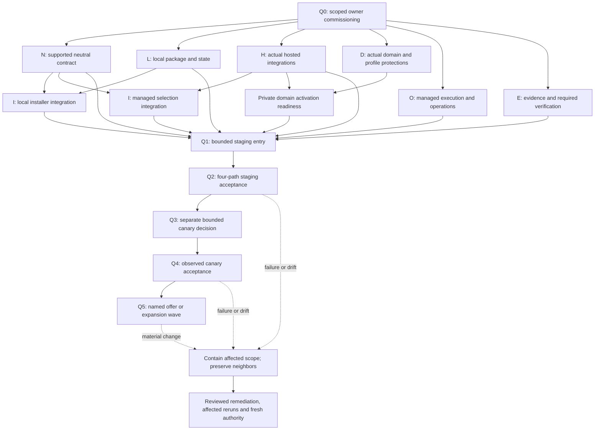

# Implementation Plan: Private connectivity production qualification

Status: draft

**Branch**: 043-private-connectivity-production | **Date**: 2026-11-13 | **Spec**: [Feature specification](spec.md)

**Input**: The three-track specification and ratified [production qualification policy](../../openspec/changes/qualify-private-connectivity-production/proposal.md).

## Summary

Coordinate local Headscale, standalone Hosted Headscale and hosted DomainxFactories through one implementation feature and the single [tasks.md](tasks.md). Reuse the landed lifecycle and authority semantics, commission exact owner changes, publish supported compatible artifacts, qualify real integrations on the intended platform, then admit a bounded canary and each commercial offer or expansion wave separately.

The existing provider/package/domain implementations are intentionally synthetic lab implementations. They are useful source baselines, not customer releases. This plan introduces no runtime grant, deployment, paid resource, new published record kind or release version. Q0 is not accepted; Q1–Q5 are not entered.

Planning decisions and source findings are in [research](research.md). Concrete candidate owner paths are in [owner scopes](owner-scopes.md). Required approval records remain in [commissioning](commissioning.md).

## Technical Context

**Language/Version**: Existing owner cores and validators use Python 3; inspected package/installer CI uses Python 3.12, and coordinator doc-health has a Python 3.14 compatibility job. Keep the existing cores while commissioning changes. Supported customer/runtime versions are C-05 decisions before Q1, not commitments inferred from developer CI.

**Primary Dependencies**: A published neutral binding contract and verifier; qualified Headscale/server and supported clients; supported package/installer/service releases; actual provider, identity, entitlement, custody, DNS/TLS and relay integrations; existing managed-subject deployment handoff; actual domain profile protection and required validation. The inspected feature 040 schema is outside the published contract bundle.

**Storage**: Existing hosted and installer operation cores use SQLite and scoped locks. Retain their durable-subject and revocation invariants; qualify the selected store, topology and fencing on the intended platform. Do not mandate a replacement database or infer production durability from fixture tests. Each managed boundary has dedicated Headscale state, endpoint, keys and policy. Current authority/revocations must be recovered from an authoritative source independent of an older instance snapshot before activation. Protected immutable evidence custody is a C-08 decision.

**Testing**: Existing owner unit/conformance commands are source evidence. Required CI must explicitly invoke the affected suites. New owner-approved qualification entry points must collect real-client positive/denial, direct/relay, lifecycle, interruption/restart, recovery and application results. A separately commissioned feature verifier validates frozen case coverage, immutable references, scope, dependencies and measurements; it never executes owner commands or manufactures observations. See [validation matrix](validation-matrix.md).

**Target Platform**: The existing owning bench is the planning/validation plane. Production provider, local support matrix, actual domain, managed subjects, regions and topology remain C-02/C-05 decisions. Provider/domain-dependent implementation is blocked until those decisions are accepted; no Azure, Eagle or lab-default platform is selected here.

**Project Type**: Cross-repository release and qualification coordination. Runtime remains in package, installer, hosted-product, domain and operational owners. This neutral repository owns policy, coordination and only separately authorized neutral publication/verification.

**Performance Goals**: C-06 supplies numeric availability/error, capacity/spend, revocation, backup age/data-loss, restore, rollback, sampling/gap and observed-window criteria before Q1, with production objectives confirmed before Q3. Measure maxima/coverage and event anchors against those exact limits. No historical lab threshold becomes a production objective.

**Constraints**: Current owner scope before runtime edits; immutable supported candidates before Q1; managed-subject execution authority before target effects; two managed customer boundaries, environment separation and all four offering paths at Q2; separately scoped Q3/Q5 decisions; no raw secrets, forced hosted subscription for customer operation, caller-selected eligibility or revival of revoked access.

**Scale/Scope**: Three delivery tracks, four offering paths, actual selected domain profiles and the accepted support matrix. Q1/Q3/Q5 decisions bound customers, sites, networks, regions, nodes/resources, spend, data and duration. A profile with no private requirement qualifies its unbound path independently.

## Constitution Check

The adopted bootstrap constitution is version 1.0.0 with its own ratification still pending; this plan does not change its status. The following checks apply to planning artifacts, not operational acceptance.

| Principle | Pre-research check | Post-design check |
| --- | --- | --- |
| I — Neutral core | Pass: product/runtime effects remain in their owners | Pass: only conceptual coordination contracts here; actual domain/provider work is separately commissioned |
| II — Governed flow | Pass: ratified policy and explicit feature/plan/tasks requests supply artifact authority | Pass: C-01 owner changes, neutral publication and shared evidence registration require their own accepted scope; one executable tasks.md |
| III — Lifecycle | Pass: new planning artifacts are draft | Pass: no Q0 or live gate is reported passed; historical lab and ratification records stay intact |
| IV — Artifact discipline | Pass: references are relative, no credentials or host paths | Pass: feature-local contracts are Markdown proposals; no published schema/version or live configuration created; README indexes outputs |
| V — Verification | Pass: planned validation has distinct source/CI/live classes | Pass: local document/governance checks recorded separately; required owner CI and live proofs are explicit prerequisites |
| VI — Content-addressed releases | Pass: no version allocation or pin advance | Pass: normal cut/manifest/changelog/generated inventory/tag verification precedes supported consumer pins |
| VII — Fail-closed authority | Pass: missing scope/decision blocks its consumer | Pass: strict profiles, original retry subjects, current revocations, evidence-class checks and fresh resume authority preserved |

No constitutional exception is requested. Planning can finish while Q0 remains unaccepted; runtime work cannot proceed on that basis.

## Project Structure

### Documentation in this feature

    specs/043-private-connectivity-production/
      spec.md
      plan.md
      research.md
      analysis.md  (analysis/remediation record; no executable tasks)
      data-model.md
      owner-scopes.md
      commissioning.md
      rollout-gates.md
      validation-matrix.md
      policy-coverage.md
      local-headscale.md
      standalone-hosted-headscale.md
      hosted-domainxfactories.md
      quickstart.md
      contracts/
        owner-handoff.md
        product-interfaces.md
        qualification-evidence.md
        task-evidence.md
      checklists/
        requirements.md
      tasks.md  (/speckit.tasks output; sole executable list)

### Owned implementation surfaces

Existing source anchors and proposed new verifier/production areas are recorded in [owner scopes](owner-scopes.md). None is an approved allowlist. Their exact file/code/CI/schema/command scopes must be accepted at C-01 before implementation.

- openXfactory: supported neutral contract publication/consumer semantics and separately commissioned feature verification; no hosted runtime.
- Headscale-Install: supported package, identity/renewal, isolated state, upgrade/backup/fenced recovery.
- xFactory-Installer: production private-connectivity adapters, setup/distribution and compatible pins; unrelated workstation-intake/Store work is excluded.
- openXsoft-Hosted-Services: actual provider/identity/entitlement/custody integrations, durable lifecycle, trusted-profile onboarding and scoped catalog authority.
- opsXfactory/managing factory: actual operational adapter, target handoff, custody, monitoring/recovery and explicit required private-connectivity CI.
- Selected actual DomainxFactory: workload, application permission, exact production profile/schema/protection and required checks. The old codeXfactory profile is a lab reference only.

**Structure decision**: Reuse owner repositories and this linked coordinating worktree. Keep one task list. Do not duplicate lab code into the neutral layer, widen lab restrictions in place, create repositories or change aggregation pins as a planning side effect.

## Phase 0 — Research and commissioning design

[Research decisions R-01–R-10](research.md) resolve the coordinating architecture: reuse owned semantics, separate lab from supported releases, gate provider/domain choices, preserve durable state and existing handoff, derive private requirements from trusted profiles, and explicitly commission validation/evidence surfaces.

Runtime choices C-01–C-13 remain required decision outputs at the consuming gates. They are not unresolved assumptions to fill with lab defaults. C-02 platform and domain selections must exist before dependent implementation. C-01 records the human acceptances and exact paths/commands; authoring this plan does not grant them.

Q0 preparation must identify the required owning governance decisions for: neutral contract publication/reader work; package and installer production scopes; actual hosted integrations; operational adapter and required CI coverage; selected domain definition/protection; feature evidence verification and narrow shared pin registration. Their governance/handoff points are in the single tasks.md before dependent implementation.

## Phase 1 — Design and contracts

- [Data model](data-model.md) describes conceptual owner, candidate, authority, operation, evidence, gate and wave records with current-scope relationships and rejection rules. It is not a published schema or replacement database design.
- [Owner handoff](contracts/owner-handoff.md) defines the scope/release/deployment boundary and verification obligations, reusing client_infrastructure_request.
- [Product interfaces](contracts/product-interfaces.md) defines required compatibility and observable lifecycle behavior across the three tracks without choosing a transport or broadening current lab contracts.
- [Qualification evidence](contracts/qualification-evidence.md) defines planned evidence/verifier semantics and gates shared-reader authorization before implementation.
- [Task evidence](contracts/task-evidence.md) binds the closed task registry, authenticated bootstrap bridge, per-instance canary/offer dependencies and final consumer/harness candidate closure. Aggregate task completion does not collapse independent approved child schedules.
- [Validation matrix](validation-matrix.md) maps source checks and future observed evidence to all feature requirements and Q gates.
- [Quickstart](quickstart.md) provides non-operational planning validation and the gated execution handoff.

## Phase 2 — Implementation dependency design

This is a workstream/dependency model, instantiated by the single task list with owner scope, prerequisite decisions, verification and halt conditions. Any decision consumed by an implementation choice must be accepted before that work, even if its latest gate deadline is Q1 or Q3; do not defer a needed support, custody, budget or capacity constraint past its actual consumer.

| Workstream | Required authority and implementation inputs | Output needed for integration/qualification |
| --- | --- | --- |
| E — Evidence and gate verification | C-01 accepted coordinator verifier/tests scope; owning authorization for shared pin reader/census changes; C-08 custody and frozen case/command rules | Tested evidence verifier and registration with required CI; no owner command execution by the verifier |
| N — Neutral supported contract | C-01 neutral publication/reader scope; existing release process | Supported contract/validator release and verified consumer compatibility/pins; no import of feature 040 draft bytes as production |
| L — Local package/state | Accepted package support/platform scope; C-04 identity/custody decisions where consumed | Supported package, renewal/reachability/state/upgrade/recovery behavior and release provenance |
| H — Managed network service | Accepted product scope; C-02 provider/platform; C-04 actual integrations | Qualified provider/identity/entitlement/custody adapters, durable original-subject operations and independent network lifetime |
| I — Installer integration | Accepted installer setup/distribution scope; supported N/L releases for local mode; H for managed mode | Customer install-new/connect-existing and unbound compatibility; managed selection after service eligibility for the same phase/scope |
| D — Actual domain/profile | C-02 actual domain; accepted exact owner profile/schema/protection/CI surfaces; N and relevant H/I interfaces | Actual workload/application permission, trusted profile-derived privacy, managed-new/existing and applicable unbound behavior, scoped eligibility |
| O — Operational integration | Accepted managing-factory/operational scope; C-02 target/channel; C-04 custody/monitoring | Governed handoff/recovery/monitoring and explicit private-connectivity CI coverage; current revocations and neighbor preservation |
| Integration and candidate freeze | Compatible outputs of E/N/L/H/I/D/O plus C-03–C-08 decisions | Exact supported candidate/support matrix, evidence/probes and target authority ready for Q1 |

L, H, D preparation, O and E can proceed independently only within their accepted Q0 scope and consumed decisions. Local package preparation does not wait on an unrelated hosted subscription/provider choice. Integration still waits on every consumed compatible release. H can develop its approved adapters alongside L; its accepted instance integration requires L's supported release. Managed I/D activation waits on eligible H for the same phase/scope, not a premature general commercial launch.

After domain-capable hosted integration and operational release, T049 closes the exact final C-05 consumer/service/profile/harness matrix against actual final-candidate source integration and required CI. Earlier component receipts do not prove a later combination. Unsupported or stale combinations require renewed exact owner work, release verification and refreshed closure before T050 preparation or Q1. Q3–Q5 then use the per-instance DAG: each canary/offer/wave needs its own accepted predecessor, while final task completion waits for all commissioned instances. A wave also requires the corresponding offer's prior admission.

The detailed dependency table governs interface readiness; the graph does not grant effects. Every post-failure resume identifies which earlier gate/evidence was invalidated and re-enters at its earliest affected gate.

## Q0–Q5 validation and acceptance

| Gate | Mandatory dependency / validation | Refusal condition |
| --- | --- | --- |
| Q0 | C-01 exact current owner/command scopes and C-02 decisions needed for that work; release/support, custody, objectives/bounds and later prerequisites assigned | Missing human acceptance, path authority or consumed platform/domain choice; policy/lab approval substituted for commissioning |
| Q1 | Compatible supported outputs and explicit owner CI; C-03 execution, C-04 integrations/custody, C-05 release/matrix, C-06 numeric limits, C-07 bounded staging and C-08 evidence/probes | Feature-local schema or local helper image treated as a release; unqualified adapter; missing mandatory check, pin, limit, target or authority |
| Q2 | V-03–V-07, V-11–V-13 actual intended-platform evidence for four offering paths, two managed boundaries and environment separation; operational drills/measurements and incident closure | Denial without positive control, missing path/drill, stale candidate, unmet objective, unobserved behavior or unresolved incident |
| Q3 | Accepted exact Q2 candidate/evidence and C-09 customer/site/network/domain/environment/region/resource/data/consent/spend/time/operator/support/rollback bounds; renewed target authority and monitoring | Staging reused as permission; absent consent; managed request or channel-required grant missing; unmanaged customer authority missing; added scope |
| Q4 | C-10 actual approved observation window, objectives, isolation/application/lifecycle results, incident closure, cleanup/readback and fresh affected-owner sign-offs | Monitoring gap counted as healthy time, unreviewed incident, wrong-scope evidence or unauthorized destructive drill |
| Q5 | C-11 named offer or C-12 individual wave; exact eligible profiles/candidate, accepted Q4 evidence, current owners/commercial decision and cohort bounds | Blanket domain/region approval, caller eligibility flag, another profile's evidence, changed scope without impact review/requalification |

[Rollout-gates.md](rollout-gates.md) remains the acceptance authority summary; [validation-matrix.md](validation-matrix.md) defines source versus observed proof. C-13 controls any resumption. A scheduled canary may differ by track/site, but all governing program staging coverage and each offering's own decisions remain required.

## Release, rollback and evidence controls

Neutral publication follows its approved atomic cut: contract files, manifest, changelog and generated inventory, with late version allocation, review, landing, annotated tag publication/readback and consumer commit/content pin verification. Source CI, supported release publication, target execution/readback and live acceptance remain separate.

Backup/recovery fences the old writer, restores in quarantine, reconciles current authority and revocations from their authoritative source, verifies identity/policy/application/neighbor behavior, rechecks activation authority and only then activates. Failed cutover removes partial target access before any still-authorized prior binding can return. Revoked, expired or no-longer-entitled prior bindings stay unavailable.

Never rewrite 040 evidence, carry its timing limits or five-role approvals forward, or relax its fixed lab safeguards to produce a customer release. Feature 043's shared evidence registration requires its own narrow owning authorization; 040 registration covers only its own evidence paths.

## Task execution and analysis handoff

The [task list](tasks.md) now instantiates this plan and its contracts. [Speckit analysis and remediation](analysis.md) records six repaired findings and no outstanding artifact issue. Begin implementation only through its commissioning/governance predecessors; retain separate source, required CI, supported release, Q1/Q2, Q3/Q4 and Q5 validation gates. Every task must name the exact owner, accepted surfaces, required decision/candidate inputs, evidence class, verification and dependency. Owner runtime work is represented once in the coordinating list. Rerun analysis if these artifacts materially change.

Governed contracts, workflows, pins, measured values, evidence readers and their tests must honor repository build-tier invariants; do not classify them as pattern-only work. No task may claim Q0–Q5 passed from the plan or an unexecuted validation case. Speckit analysis must clear critical findings before implementation. OpenSpec task 2.1 records only the verified spec/plan/tasks handoff. Task 2.2 and Q0 remain open until actual accepted owner scopes and consumed decisions exist.
