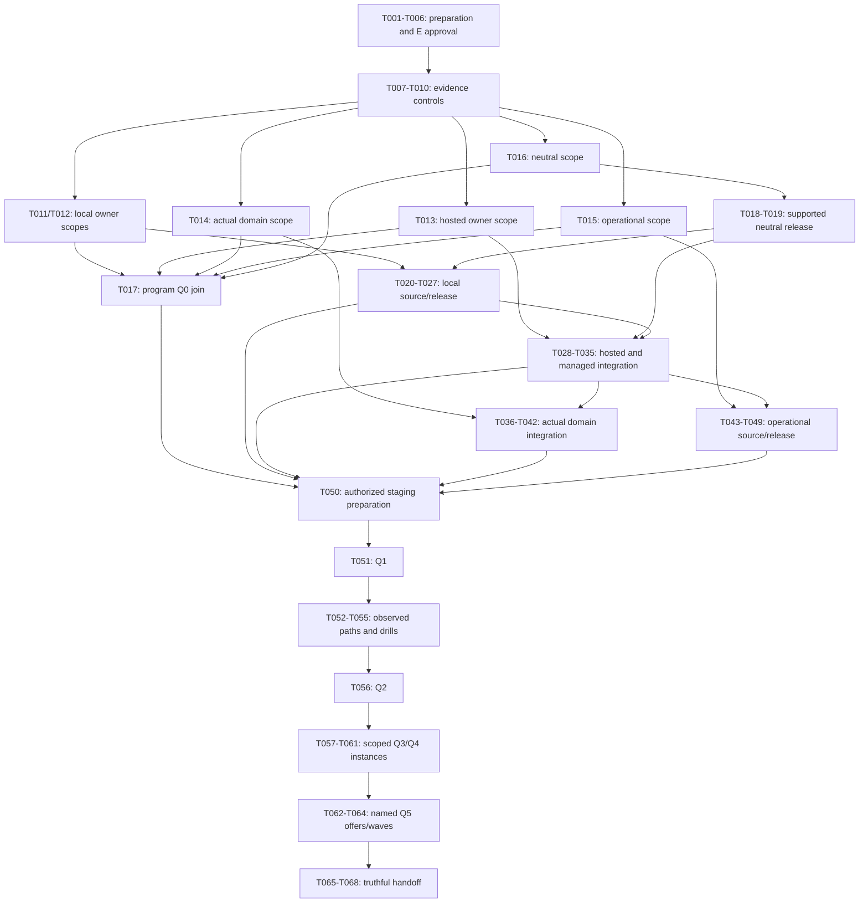

# Tasks: Private connectivity production qualification

Status: draft
Created: 2026-11-13
Feature: [043-private-connectivity-production](spec.md)

**Input**: [Plan](plan.md), [specification](spec.md), [research](research.md), [logical model](data-model.md), [owner scopes](owner-scopes.md), [commissioning](commissioning.md), [rollout gates](rollout-gates.md), [validation matrix](validation-matrix.md) and [draft contracts](contracts/task-evidence.md).

This is the sole executable implementation list. Generation does not execute a task, ratify an owner proposal, pass Q0 or enter Q1–Q5. Every task is initially unchecked. Actual human approvals and consumed decisions remain prerequisites.

## Format and execution contract

Each task retains the required checkbox/ID/parallel/story/tier format and exactly two trailing fields, files and verify. The shared build-tier rubric applies: [O] is used for new interfaces, contracts, security, cross-module work and procedure-heavy releases/landings; [S] only for bounded preparation. No [H] task is used. Tier tags are retained across agent runtimes; scope and verification always apply.

Owner/dependency/gate/case metadata is in the description. [P] means potentially concurrent only after every dependency and consumed decision is complete, with disjoint effective write sets and frozen inputs. It grants no authority.

### Owner roots and effective file scope

| Alias | Code tree for that task |
| --- | --- |
| C | This openXfactory 043 linked feature worktree |
| L | Accepted opensoft/Headscale-Install implementation worktree |
| I | Accepted opensoft/xFactory-Installer implementation worktree |
| H | Accepted opensoft/openXsoft-Hosted-Services implementation worktree |
| O | Accepted opensoft/opsXfactory / target managing-factory implementation worktree |
| D | Actual DomainxFactory repository/worktree selected and admitted under C-02/C-01; no default domain |

The files field is relative to the named owner code tree. Every task has one owner and writes only that tree. Directory entries are proposed envelopes, not grants: the effective scope is their strict intersection with the immutable exact per-task C-01 file list. Profile protection, schemas, CI, pins and measured witnesses require exact accepted surfaces. If the selected owner layout or implementation needs a file outside that intersection, stop and replan before editing; never broaden a directory prefix silently.

From T010 onward owner evidence receipts use evidence/private-connectivity-production/TNNN.json in that owner tree; coordinator receipts use this feature's evidence/TNNN.json. T001–T009 use the closed authenticated bootstrap bridge in the [evidence contract](contracts/task-evidence.md#bootstrap-evidence-bridge); their file scopes do not require new task receipts. Production outputs/failed attempts remain immutable in C-08 custody under references, without raw secrets/customer payloads. A receipt may aggregate references to distinct scoped attempts, but must validate every child independently and cannot mix their candidate/scope into one invented pass.

External-owner verify commands require machine-local PC_COORDINATOR to resolve this exact accepted coordinator checkout. The future verifier must confirm repository, feature and approved owner-root/revision mapping before trusting any path. Host-absolute paths are not committed.

### Completion and authority rules

- T001–T006 bootstrap using existing read-only commands; the new verifier is not a prerequisite of its own approval/implementation. T006 requires a real named-owner acceptance and cited ratification record. Metadata or the task text cannot supply consent.
- T007–T010 create the separately authorized verifier/registration/required-CI controls. Later verify commands are planned CLI invocations made available by those tasks; they are not existing commands today.
- Every task also needs an exact diff/scope check and review of its stated outcomes. A green command alone is not authority or proof that new behavior was implemented.
- Tests are required by this feature's conformance/CI/security acceptance. Within implementation tasks, observe the intended new regression fail before the implementation and pass afterward. A missing dependency/harness error is not a valid red test.
- The verifier reads frozen cases, actual owner commands/results, immutable dependencies, scope and approvals. It never runs owner commands or grants a pass from self-reported verdict text. Owner/reviewer confirmation of actual outputs remains required.
- The current code_surface:none policy is not a runtime grant. Evidence/shared-reader, neutral publication and each component production scope need their owning decisions. Proposal IDs below are proposed governance destinations, not existing approved changes; verify availability/canonical ownership before authoring and replan if the owner requires another store.
- Shared README/corpus ledger/proposal publication is serialized even when owner reviews happen concurrently. Use the assigned proposal PR number and sanctioned ledger generator; never hand-edit ledger rows.
- Readiness is task-DAG based, not a demand to wait for every lower ID. A missing hosted choice must not prevent already commissioned local work. T017 is not a prerequisite of T020: it is the program join before T050/Q1.
- Source/CI/release receipts do not satisfy staging/production observations. All numbers, support matrices and authority must be accepted before their actual consumer, even if a later gate is their latest deadline.
- All live effects use actual approved operator/executor identities and C-03/C-07/C-09/C-12 bounds, never producer standing credentials. Q0 preparation, Q1 staging, Q3 activation and Q5 admission are distinct.
- Every first-offering canary/wave instance has separate scope, decisions, observation and sign-offs. A missing required instance stays blocked/ineligible; another instance's pass cannot fill it. A checked task remains historical evidence, not permission for another wave.
- T057–T064 dependencies are evaluated per frozen approved child instance; their final checkboxes require every commissioned child. A passed same-scope child may advance without a parent aggregate, while T056 remains the full program Q2 predecessor. The [instance rules](contracts/task-evidence.md#per-instance-q3q5-dependencies) distinguish approved child progress from aggregate completion and require the corresponding offer's admission before wave execution.
- Failed/blocked attempts are retained immutably in protected custody. Final task receipts reference the accepted attempts and prior remediation; never overwrite an accepted observation or manufacture a pass. Later material changes create new scoped attempts and re-enter the earliest invalidated gate.

## Phase 1: Setup — verify the existing feature

**Goal**: Confirm the linked feature and historical lab baseline without changing runtime or claiming production permission.

**Independent verification**: The current 043 spec/plan/tasks resolve together; the historical snapshot matches approved 040 content and explicitly grants no production authority.

- [x] T001 [S] Confirm the linked 043 feature, specification/plan/contracts, existing planning checklist and unchanged 040/runtime baseline before any write (Owner=C; depends=none; gate=setup; cases=feature-context,prior-work-preserved.) — files: `specs/043-private-connectivity-production/checklists/requirements.md` — verify: `bash .specify/scripts/bash/check-prerequisites.sh --json --require-tasks --include-tasks`

- [x] T002 [O] Record the approved 040 T021 content identity as historical lab evidence with authorizes_production=false; retain the original packet untouched (Owner=C; depends=T001; gate=historical-source; cases=historical-lab-only,content-identity,no-production-grant.) — files: `specs/043-private-connectivity-production/evidence/baseline.json` — verify: `python3 -c 'import json,hashlib; from pathlib import Path; d=json.loads(Path("specs/043-private-connectivity-production/evidence/baseline.json").read_text()); p=Path("specs/040-private-connectivity/evidence/T021.json"); assert d["evidence_class"]=="historical-lab"; assert d["authorizes_production"] is False; assert d["evidence_sha256"]==hashlib.sha256(p.read_bytes()).hexdigest(); assert json.loads(p.read_text())["verdict"]=="pass"'`

## Phase 2: Foundational — proposed governance and verifier contract

**Goal**: Prepare the root evidence and neutral-publication governance packets and freeze this task/evidence design for owner review.

**Independent verification**: Both specific proposals validate and their generated ledger/index attribution is correct; the closed task/case registry equals this list. Drafts are not grants.

- [x] T003 [O] Draft and publish the narrow evidence/verifier/registration/required-CI OpenSpec proposal; use its assigned PR number with the sanctioned ledger seed and index the draft (Owner=C; depends=T001,T002; gate=governance-draft; cases=exact-evidence-scope,shared-reader-scope,publication-index.) — files: `openspec/changes/commission-private-connectivity-production-evidence/`, `README.md`, `tests/sequenced_after/corpus-ledger.yaml` — verify: `python3 scripts/validate-openspec-cli-pin.py --change commission-private-connectivity-production-evidence --strict`

- [x] T004 [O] Draft and publish the neutral binding publication/reader/conformance/release-cut OpenSpec proposal; allocate no version, and regenerate/index with its actual PR number (Owner=C; depends=T003; gate=governance-draft; cases=neutral-publication-scope,atomic-release-process,publication-index.) — files: `openspec/changes/publish-private-connectivity-production-contract/`, `README.md`, `tests/sequenced_after/corpus-ledger.yaml` — verify: `python3 scripts/validate-openspec-cli-pin.py --change publish-private-connectivity-production-contract --strict`

- [x] T005 [O] Review and freeze the proposed task/owner/case/dependency contract for evidence-owner approval, preserving all feature and governing scenario coverage (Owner=C; depends=T003,T004; gate=design-freeze; cases=closed-task-registry,complete-coverage,no-authority-by-draft.) — files: `specs/043-private-connectivity-production/contracts/task-evidence.md`, `specs/043-private-connectivity-production/validation-matrix.md`, `specs/043-private-connectivity-production/policy-coverage.md` — verify: `python3 -c 'import re; from pathlib import Path; p=Path("specs/043-private-connectivity-production"); a=set(re.findall(r"^- \[[ xX]\] (T[0-9]{3}) ",(p/"tasks.md").read_text(),re.M)); c=set(re.findall(r"^\| (T[0-9]{3}) \|",(p/"contracts/task-evidence.md").read_text(),re.M)); assert a and a==c; assert len(a)==68'`

## Phase 3: User Story 1 — commission accountable owners (P1)

**Goal**: Obtain actual scoped owner decisions, build the separately commissioned evidence controls and supply a supported neutral release.

**Independent verification**: Each owner's missing/expired decision blocks its consumer. E can be partially commissioned without a hosted platform; local runtime can follow Q0-L without waiting for unrelated Q0-H/Q0-D. The program Q0 join and neutral publication have their own proof.

- [x] T006 [US1] [O] Obtain actual named-owner ratification of the evidence proposal and record only the exact coordinator E scope and consumed C-08 bootstrap-evidence custody/authentication decisions; missing approval blocks helper implementation, not an invitation to self-approve (Owner=C; depends=T005; gate=Q0-E; cases=actual-owner-acceptance,exact-partial-scope,no-live-grant.) — files: `openspec/changes/commission-private-connectivity-production-evidence/`, `README.md`, `tests/sequenced_after/corpus-ledger.yaml` — verify: `python3 -c 'import yaml,subprocess; from pathlib import Path; p=Path("openspec/changes/commission-private-connectivity-production-evidence"); o=yaml.safe_load((p/".openspec.yaml").read_text())["origin"]; assert o.get("approved_by") and o.get("approved_on"); assert "Status: ratified" in (p/"proposal.md").read_text(); assert (p/"review/ratification.md").is_file(); assert "Ratified:" in (p/"review/ratification.md").read_text(); subprocess.run(["python3","scripts/validate-openspec-cli-pin.py","--change","commission-private-connectivity-production-evidence","--strict"],check=True)'`

- [x] T007 [P] [US1] [O] Implement the commissioned read-only verifier with authenticated T001–T009 bootstrap imports and per-instance canary/offer dependency checks, plus regressions for every frozen task/case, authority/evidence class, immutable dependency, command/output, scope and finite-limit rule; tests precede implementation within the task (Owner=C; depends=T006; gate=source-E; cases=frozen-cases,class-scope-dependencies,limits-authority-rejection,read-only-verifier.) — files: `specs/043-private-connectivity-production/verify-evidence.py`, `specs/043-private-connectivity-production/tests/test_evidence.py` — verify: `python3 -m pytest specs/043-private-connectivity-production/tests/test_evidence.py -q`

- [x] T008 [P] [US1] [O] Implement the commissioned exact 043 pin inventory generator/checker and regressions, distinguishing write and check modes without extending 040 coverage (Owner=C; depends=T006; gate=source-E; cases=exact-043-inventory,owner-reachability,read-only-check-mode.) — files: `specs/043-private-connectivity-production/register-evidence-pins.py`, `specs/043-private-connectivity-production/tests/test_evidence_pins.py` — verify: `python3 -m pytest specs/043-private-connectivity-production/tests/test_evidence_pins.py -q`

- [x] T009 [US1] [O] Implement only the newly ratified shared-reader registration and directly affected regressions/census; retain uncovered-site and owner reachability checks (Owner=C; depends=T007,T008; gate=source-E; cases=only-043-coverage,uncovered-path-refusal,census-regressions.) — files: `scripts/doc_health/pin_class.py`, `tests/doc-health/test_pin_reachability.py`, `tests/doc-health/test_sentinel_vocabulary.py` — verify: `python3 -m pytest tests/doc-health/test_pin_reachability.py tests/doc-health/test_sentinel_vocabulary.py -q`

- [ ] T010 [US1] [O] Wire the new feature verifier/registration suites into the approved required CI entry point and record actual exact-head collection/pass receipts; preserve all existing check/count/floor obligations (Owner=C; depends=T009; gate=CI-E; cases=explicit-suite-collection,exact-head-required-ci,no-skips-or-waivers.) — files: `.github/workflows/pytest-suite.yml`, `specs/043-private-connectivity-production/evidence/T010.json` — verify: `python3 specs/043-private-connectivity-production/verify-evidence.py --task T010 specs/043-private-connectivity-production/evidence/T010.json`

- [ ] T011 [US1] [O] Obtain and record the Headscale package owner's accepted exact production scope, local support/platform choices, consumed custody/limit decisions and scoped Q0-L acceptance; publish/ratify its owning packet without inheriting lab authority (Owner=C; depends=T010; gate=Q0-L; cases=package-owner-scope,local-platform-support,consumed-decisions.) — files: `openspec/changes/commission-headscale-production/`, `README.md`, `tests/sequenced_after/corpus-ledger.yaml`, `specs/043-private-connectivity-production/evidence/T011.json` — verify: `python3 specs/043-private-connectivity-production/verify-evidence.py --task T011 specs/043-private-connectivity-production/evidence/T011.json`

- [ ] T012 [US1] [O] Obtain and record the installer's exact private-connectivity adapter/setup/distribution scope, support/channel choices and Q0-I acceptance; exclude workstation-intake and Store work (Owner=C; depends=T010; gate=Q0-I; cases=installer-owner-scope,setup-distribution-scope,no-workstation-intake.) — files: `openspec/changes/commission-connectivity-installer-production/`, `README.md`, `tests/sequenced_after/corpus-ledger.yaml`, `specs/043-private-connectivity-production/evidence/T012.json` — verify: `python3 specs/043-private-connectivity-production/verify-evidence.py --task T012 specs/043-private-connectivity-production/evidence/T012.json`

- [ ] T013 [US1] [O] Obtain actual provider/platform and integration decisions plus the hosted-product owner's exact production scope/Q0-H acceptance; no Eagle, provider, budget or identity default may fill missing decisions (Owner=C; depends=T010; gate=Q0-H; cases=actual-provider-platform,identity-entitlement-custody,product-owner-scope.) — files: `openspec/changes/commission-hosted-headscale-production/`, `README.md`, `tests/sequenced_after/corpus-ledger.yaml`, `specs/043-private-connectivity-production/evidence/T013.json` — verify: `python3 specs/043-private-connectivity-production/verify-evidence.py --task T013 specs/043-private-connectivity-production/evidence/T013.json`

- [ ] T014 [US1] [O] Select the actual domain/repository/profile through C-02 and obtain exact owner schema/protection/required-validation/workload scope and Q0-D acceptance; block on any separately required repository admission (Owner=C; depends=T010; gate=Q0-D; cases=actual-domain-selection,exact-profile-protection-scope,owner-and-inventory-authority.) — files: `openspec/changes/commission-hosted-domain-production/`, `README.md`, `tests/sequenced_after/corpus-ledger.yaml`, `specs/043-private-connectivity-production/evidence/T014.json` — verify: `python3 specs/043-private-connectivity-production/verify-evidence.py --task T014 specs/043-private-connectivity-production/evidence/T014.json`

- [ ] T015 [US1] [O] Obtain the managing-factory/operational owner's exact target/channel/adapter/monitoring/recovery and required private-suite CI scope with Q0-O acceptance; preserve existing request/approval/correlation rules (Owner=C; depends=T010; gate=Q0-O; cases=target-channel-custody,operational-owner-scope,explicit-ci-scope.) — files: `openspec/changes/commission-connectivity-operations-production/`, `README.md`, `tests/sequenced_after/corpus-ledger.yaml`, `specs/043-private-connectivity-production/evidence/T015.json` — verify: `python3 specs/043-private-connectivity-production/verify-evidence.py --task T015 specs/043-private-connectivity-production/evidence/T015.json`

- [ ] T016 [US1] [O] Obtain actual neutral publication/reader/release-owner acceptance of the publication proposal and record Q0-N without allocating a bundle version or advancing pins (Owner=C; depends=T010,T004; gate=Q0-N; cases=neutral-owner-acceptance,publication-reader-scope,late-version-allocation.) — files: `openspec/changes/publish-private-connectivity-production-contract/`, `README.md`, `tests/sequenced_after/corpus-ledger.yaml`, `specs/043-private-connectivity-production/evidence/T016.json` — verify: `python3 specs/043-private-connectivity-production/verify-evidence.py --task T016 specs/043-private-connectivity-production/evidence/T016.json`

- [ ] T017 [US1] [O] Assemble the program Q0 decision from current per-owner acceptances and consumed C-02–C-08 choices; explicitly assign later inputs to their gates and do not convert pending decisions into passes (Owner=C; depends=T011,T012,T013,T014,T015,T016; gate=Q0-program; cases=all-owner-scopes,consumed-choices-accepted,later-gates-still-pending.) — files: `specs/043-private-connectivity-production/commissioning.md`, `specs/043-private-connectivity-production/owner-scopes.md`, `specs/043-private-connectivity-production/evidence/T017.json` — verify: `python3 specs/043-private-connectivity-production/verify-evidence.py --task T017 specs/043-private-connectivity-production/evidence/T017.json`

- [ ] T018 [US1] [O] Implement neutral publication/reader conformance and complete the approved atomic manifest/changelog/generated-inventory cut, reviewed landing and annotated-tag publication; use the normal release process and current release authority (Owner=C; depends=T016,T010; gate=release-N; cases=supported-contract,atomic-cut,conformance,publication-authority.) — files: `contracts/private-connectivity/`, `contracts/manifest.yaml`, `contracts/CHANGELOG.md`, `contracts/releases/`, `scripts/validate-private-connectivity.py`, `tests/private_connectivity/`, `specs/043-private-connectivity-production/evidence/T018.json` — verify: `python3 specs/043-private-connectivity-production/verify-evidence.py --task T018 specs/043-private-connectivity-production/evidence/T018.json`

- [ ] T019 [US1] [O] Independently verify the released neutral contract/validator, tag/commit/content and compatibility handoff before any production consumer pin is accepted (Owner=C; depends=T018; gate=release-N-verified; cases=tag-readback,compatible-content-pins,no-pilot-import.) — files: `specs/043-private-connectivity-production/evidence/T019.json` — verify: `python3 specs/043-private-connectivity-production/verify-evidence.py --task T019 specs/043-private-connectivity-production/evidence/T019.json`

**Checkpoint**: Q0 is not automatically passed. T011–T016 accept only their exact scopes; T017 is the program join. The supported neutral release is not target execution or commercial permission.

## Phase 4: User Story 2 — supported local Headscale (P1)

**Goal**: Produce supported package, local adapter and private-connectivity distribution candidates while preserving independent customer operation.

**Independent verification**: Source/CI exercises new/existing/unbound, valid/invalid endpoint, renewal, protected state, retry/cutover and current prior authority. Actual L cases are observed at T052/T055; managed selection also requires T034–T035/T053.

- [ ] T020 [US2] [O] Implement the commissioned supported package/instance foundation and reproducible image/helper inputs with regression coverage; preserve fixed lab controls and expose no unapproved target (Owner=L; depends=T011,T010; gate=source-L; cases=supported-package-foundation,real-release-inputs,lab-preserved.) — files: `deploy/production/instance.py`, `packaging/production-images.json`, `tests/qualification/test_production_package.py`, `evidence/private-connectivity-production/T020.json` — verify: `python3 "${PC_COORDINATOR:?}/specs/043-private-connectivity-production/verify-evidence.py" --task T020 evidence/private-connectivity-production/T020.json`

- [ ] T021 [P] [US2] [O] Implement customer-controlled endpoint identity/renewal/reachability and supported-client checks, including invalid identity refusals; no hosted subscription requirement (Owner=L; depends=T020; gate=source-L; cases=verified-endpoint,renewal-reachability,no-tls-bypass.) — files: `deploy/production/endpoint.py`, `tests/qualification/test_production_endpoint.py`, `evidence/private-connectivity-production/T021.json` — verify: `python3 "${PC_COORDINATOR:?}/specs/043-private-connectivity-production/verify-evidence.py" --task T021 evidence/private-connectivity-production/T021.json`

- [ ] T022 [P] [US2] [O] Implement protected backup/upgrade/restore and single-writer fencing with authoritative current revocations before activation; add rollback/network-identity regressions (Owner=L; depends=T020; gate=source-L; cases=protected-state,fenced-quarantine-restore,current-revocations.) — files: `deploy/production/recovery.py`, `tests/qualification/test_production_recovery.py`, `evidence/private-connectivity-production/T022.json` — verify: `python3 "${PC_COORDINATOR:?}/specs/043-private-connectivity-production/verify-evidence.py" --task T022 evidence/private-connectivity-production/T022.json`

- [ ] T023 [US2] [O] Implement the guarded real-client package qualification entry point, require its source regressions, and publish/read back the approved supported package candidate and release provenance without commercial activation (Owner=L; depends=T021,T022; gate=release-L; cases=package-ci,supported-artifact,guarded-qualification-command.) — files: `tests/qualification/qualify_production.py`, `tests/qualification/test_production_runner.py`, `.github/workflows/qualification.yml`, `release/`, `docs/runbooks/production-package.md`, `evidence/private-connectivity-production/T023.json` — verify: `python3 "${PC_COORDINATOR:?}/specs/043-private-connectivity-production/verify-evidence.py" --task T023 evidence/private-connectivity-production/T023.json`

- [ ] T024 [US2] [O] Implement the production local adapter and selection integration for install-new/connect-existing/unbound, consuming verified released contract/package pins and retaining readiness/refusal regressions (Owner=I; depends=T012,T019,T023; gate=source-I-local; cases=install-new-existing,unbound-opt-in,published-contract-package-pins.) — files: `src/private_connectivity/local_provider.py`, `src/private_connectivity/selection.py`, `src/private_connectivity/contract-pin.json`, `src/private_connectivity/headscale-pin.json`, `src/private_connectivity/vendor/`, `src/private_connectivity/runtime-inventory.json`, `tests/private_connectivity/test_production_local.py`, `evidence/private-connectivity-production/T024.json` — verify: `python3 "${PC_COORDINATOR:?}/specs/043-private-connectivity-production/verify-evidence.py" --task T024 evidence/private-connectivity-production/T024.json`

- [ ] T025 [US2] [O] Extend installer migration/retry/cleanup tests and implementation so partial target access is removed and only a currently authorized prior binding can return after interruption/restart (Owner=I; depends=T024; gate=source-I-local; cases=durable-cleanup-subjects,cutover-order,revoked-prior-refusal.) — files: `src/private_connectivity/selection.py`, `tests/private_connectivity/test_migration.py`, `tests/private_connectivity/test_production_migration.py`, `evidence/private-connectivity-production/T025.json` — verify: `python3 "${PC_COORDINATOR:?}/specs/043-private-connectivity-production/verify-evidence.py" --task T025 evidence/private-connectivity-production/T025.json`

- [ ] T026 [US2] [O] Implement only the commissioned private-connectivity distribution/support channel and guarded local qualification command, then publish the local SDK/setup candidate with exact CI/provenance evidence (Owner=I; depends=T025; gate=release-I-local; cases=accepted-distribution-matrix,local-ci,guarded-local-runner.) — files: `packaging/private-connectivity/`, `release/private-connectivity/`, `tests/private_connectivity/qualify_production.py`, `tests/private_connectivity/test_production_runner.py`, `docs/private-connectivity.md`, `.github/workflows/validate.yml`, `evidence/private-connectivity-production/T026.json` — verify: `python3 "${PC_COORDINATOR:?}/specs/043-private-connectivity-production/verify-evidence.py" --task T026 evidence/private-connectivity-production/T026.json`

- [ ] T027 [US2] [O] Collect local package/installer exact-source CI and supported-release compatibility evidence; record local source readiness while leaving managed selection and all Q2 observations pending (Owner=C; depends=T019,T023,T026; gate=source-local-ready; cases=local-source-release-chain,independent-customer-operation,live-proof-not-claimed.) — files: `specs/043-private-connectivity-production/evidence/T027.json` — verify: `python3 specs/043-private-connectivity-production/verify-evidence.py --task T027 specs/043-private-connectivity-production/evidence/T027.json`

**Checkpoint**: The local source/release slice is independently testable without a hosted subscription. Source readiness is not Q2 or a local production canary.

## Phase 5: User Story 3 — standalone Hosted Headscale (P1)

**Goal**: Produce actual provider/identity/entitlement/custody and durable managed lifecycle, plus the compatible local-managed adapter.

**Independent verification**: Source/CI proves trusted authority, original subjects across restart, independent network/subscription lifetimes and exact catalog rejection. Actual standalone/local-managed controls run at T053 and operational drills at T055.

- [ ] T028 [P] [US3] [O] Implement the selected actual provider/instance integration against the released package with source regressions and no synthetic provider fallback (Owner=H; depends=T013,T019,T023; gate=source-H; cases=actual-provider,dedicated-boundaries,no-docker-fallback.) — files: `services/network-provisioning/production/provider.py`, `tests/qualification/test_production_provider.py`, `release/install-pin.json`, `evidence/private-connectivity-production/T028.json` — verify: `python3 "${PC_COORDINATOR:?}/specs/043-private-connectivity-production/verify-evidence.py" --task T028 evidence/private-connectivity-production/T028.json`

- [ ] T029 [P] [US3] [O] Implement actual identity, entitlement and credential-custody adapters under the accepted integration decisions; reject caller-created authority and expired/replayed/mismatched material (Owner=H; depends=T013,T019; gate=source-H; cases=trusted-identity,actual-entitlement,credential-custody.) — files: `services/network-provisioning/production/identity.py`, `services/network-provisioning/production/entitlement.py`, `services/network-provisioning/production/custody.py`, `tests/qualification/test_production_authority.py`, `evidence/private-connectivity-production/T029.json` — verify: `python3 "${PC_COORDINATOR:?}/specs/043-private-connectivity-production/verify-evidence.py" --task T029 evidence/private-connectivity-production/T029.json`

- [ ] T030 [US3] [O] Integrate the approved persistence/topology with durable operation fingerprints, immutable subjects, tombstones, conditional updates and qualified locking/fencing; retain original cleanup authority across restarts (Owner=H; depends=T028,T029; gate=source-H; cases=restart-durability,original-subjects,current-authorization,concurrency.) — files: `services/network-provisioning/service.py`, `services/network-provisioning/operations.py`, `tests/qualification/test_operations.py`, `tests/qualification/test_production_operations.py`, `evidence/private-connectivity-production/T030.json` — verify: `python3 "${PC_COORDINATOR:?}/specs/043-private-connectivity-production/verify-evidence.py" --task T030 evidence/private-connectivity-production/T030.json`

- [ ] T031 [US3] [O] Implement actual standalone provisioning, scoped sharing/enrollment/revocation, original-subject cancellation and separately authorized network termination while preserving unrelated entitled service (Owner=H; depends=T030; gate=source-H; cases=standalone-without-factory,scoped-attachments-routes,independent-cancellation.) — files: `services/network-provisioning/service.py`, `services/network-provisioning/attachments.py`, `services/network-provisioning/supervisor.py`, `tests/qualification/test_production_lifecycle.py`, `evidence/private-connectivity-production/T031.json` — verify: `python3 "${PC_COORDINATOR:?}/specs/043-private-connectivity-production/verify-evidence.py" --task T031 evidence/private-connectivity-production/T031.json`

- [ ] T032 [P] [US3] [O] Implement a strict production catalog/qualification interface with owner-approved schema semantics, exact profile identity/scope validation and current release authority; do not require an actual domain selection until T040 integration, or qualify by changing a test literal or caller flag (Owner=H; depends=T013,T019; gate=source-H-catalog; cases=strict-production-semantics,trusted-release-authority,no-caller-eligibility.) — files: `services/catalog/production.py`, `services/catalog/qualification.py`, `tests/qualification/test_production_catalog.py`, `evidence/private-connectivity-production/T032.json` — verify: `python3 "${PC_COORDINATOR:?}/specs/043-private-connectivity-production/verify-evidence.py" --task T032 evidence/private-connectivity-production/T032.json`

- [ ] T033 [US3] [O] Implement the actual-platform guarded network qualification runner, wire required source checks and publish the supported standalone service candidate; profiles stay customer-ineligible until their own qualification/release (Owner=H; depends=T031,T032; gate=release-H-network; cases=explicit-source-ci,guarded-network-runner,supported-service-release.) — files: `tests/qualification/qualify_production.py`, `tests/qualification/test_production_runner.py`, `.github/workflows/qualification.yml`, `release/runtime-inventory.json`, `release/install-pin.json`, `docs/production-headscale.md`, `evidence/private-connectivity-production/T033.json` — verify: `python3 "${PC_COORDINATOR:?}/specs/043-private-connectivity-production/verify-evidence.py" --task T033 evidence/private-connectivity-production/T033.json`

- [ ] T034 [US3] [O] Integrate the production managed adapter/router with the released hosted service, scoped enrollment/cleanup and renewed prior authority; update compatible pins and source regressions (Owner=I; depends=T012,T026,T033; gate=source-I-managed; cases=actual-service-integration,current-entitlement-attachment,original-retry-scope.) — files: `src/private_connectivity/managed_provider.py`, `src/private_connectivity/selection.py`, `src/private_connectivity/runtime-inventory.json`, `tests/private_connectivity/test_managed.py`, `tests/private_connectivity/test_production_managed.py`, `evidence/private-connectivity-production/T034.json` — verify: `python3 "${PC_COORDINATOR:?}/specs/043-private-connectivity-production/verify-evidence.py" --task T034 evidence/private-connectivity-production/T034.json`

- [ ] T035 [US3] [O] Extend the guarded installer qualification entry point for actual managed selection and publish/read back the compatible SDK/setup candidate; retain local/unbound behavior (Owner=I; depends=T034; gate=release-I-managed; cases=managed-source-ci,guarded-managed-runner,supported-sdk-release.) — files: `tests/private_connectivity/qualify_production.py`, `tests/private_connectivity/test_production_runner.py`, `.github/workflows/validate.yml`, `release/private-connectivity/`, `docs/private-connectivity.md`, `evidence/private-connectivity-production/T035.json` — verify: `python3 "${PC_COORDINATOR:?}/specs/043-private-connectivity-production/verify-evidence.py" --task T035 evidence/private-connectivity-production/T035.json`

**Checkpoint**: The service can qualify independently of factory subscriptions. Actual domain eligibility and all live gates remain separate.

## Phase 6: User Story 4 — each actual hosted DomainxFactory (P1)

**Goal**: Qualify the selected actual workload/profile definition and source integration, with required exact protection and trusted privacy/application authority.

**Independent verification**: Missing schema/dependency/protection, caller privacy/eligibility flags, wrong profile/domain/environment and missing app permission are rejected. Actual private-new/existing and applicable unbound observations run at T054.

- [ ] T036 [US4] [O] Implement the selected actual workload/profile, access/lifecycle and strict production schema/application-authority regressions in its accepted owner layout; do not widen the lab profile in place (Owner=D; depends=T014,T019; gate=source-D; cases=actual-workload-profile,strict-schema,application-authority.) — files: `profiles/hosted/`, `schemas/`, `src/`, `tests/private_connectivity/`, `evidence/private-connectivity-production/T036.json` — verify: `python3 "${PC_COORDINATOR:?}/specs/043-private-connectivity-production/verify-evidence.py" --task T036 evidence/private-connectivity-production/T036.json`

- [ ] T037 [US4] [O] Establish exact definition-time protection and fail-closed required schema/semantic/dependency validation for every selected production profile; prove actual required suite collection rather than warning/skip success (Owner=D; depends=T036; gate=CI-D; cases=exact-definition-protection,required-validation-collected,missing-dependency-fails.) — files: `scripts/`, `tests/private_connectivity/`, `tests/merge-master/`, `.github/workflows/`, `evidence/private-connectivity-production/T037.json` — verify: `python3 "${PC_COORDINATOR:?}/specs/043-private-connectivity-production/verify-evidence.py" --task T037 evidence/private-connectivity-production/T037.json`

- [ ] T038 [US4] [O] Implement the guarded actual-domain qualification entry point and publish/read back the approved domain/profile candidate with supported neutral/service/SDK content pins and source CI (Owner=D; depends=T037,T033,T035; gate=release-D; cases=compatible-domain-release,guarded-actual-domain-runner,profile-pins.) — files: `tests/private_connectivity/qualify_production.py`, `tests/private_connectivity/test_production_runner.py`, `stack.yaml`, `release/`, `docs/hosted-connectivity.md`, `evidence/private-connectivity-production/T038.json` — verify: `python3 "${PC_COORDINATOR:?}/specs/043-private-connectivity-production/verify-evidence.py" --task T038 evidence/private-connectivity-production/T038.json`

- [ ] T039 [US4] [O] Replace the synthetic binder path for production with actual-workload onboarding derived from the trusted exact profile; enforce application permission, private/unbound distinction and durable partial-effect cleanup (Owner=H; depends=T038,T035; gate=source-H-domain; cases=trusted-profile-privacy,actual-workload-binding,application-denial,partial-cleanup.) — files: `services/factory-onboarding/production_binder.py`, `services/factory-onboarding/onboarding.py`, `tests/qualification/test_production_onboarding.py`, `release/installer-pin.json`, `release/domain-profile-pin.json`, `evidence/private-connectivity-production/T039.json` — verify: `python3 "${PC_COORDINATOR:?}/specs/043-private-connectivity-production/verify-evidence.py" --task T039 evidence/private-connectivity-production/T039.json`

- [ ] T040 [US4] [O] Integrate the actual domain/profile schema and trusted release/evidence authority into catalog admission, with stale/foreign/unknown-profile and caller-flag regressions; keep unqualified profiles ineligible (Owner=H; depends=T039,T032; gate=source-H-domain; cases=exact-profile-catalog-integration,wrong-scope-refusal,no-premature-eligibility.) — files: `services/catalog/production.py`, `services/catalog/qualification.py`, `tests/qualification/test_production_catalog_integration.py`, `release/domain-inventory.json`, `evidence/private-connectivity-production/T040.json` — verify: `python3 "${PC_COORDINATOR:?}/specs/043-private-connectivity-production/verify-evidence.py" --task T040 evidence/private-connectivity-production/T040.json`

- [ ] T041 [US4] [O] Publish/read back the domain-capable hosted service candidate and qualified onboarding/catalog runner revision against the exact domain/installer releases; no commercial eligibility is granted by publication (Owner=H; depends=T040; gate=release-H-domain; cases=domain-capable-service-ci,compatible-pin-set,supported-release.) — files: `tests/qualification/qualify_production.py`, `tests/qualification/test_production_runner.py`, `.github/workflows/qualification.yml`, `release/runtime-inventory.json`, `release/installer-pin.json`, `release/domain-profile-pin.json`, `evidence/private-connectivity-production/T041.json` — verify: `python3 "${PC_COORDINATOR:?}/specs/043-private-connectivity-production/verify-evidence.py" --task T041 evidence/private-connectivity-production/T041.json`

- [ ] T042 [US4] [O] Collect the actual profile/protection, application, onboarding and compatible release/CI chain while leaving all live qualification and customer eligibility pending (Owner=C; depends=T038,T041,T035; gate=source-domain-ready; cases=actual-domain-source-release-chain,profile-protection-proof,live-proof-not-claimed.) — files: `specs/043-private-connectivity-production/evidence/T042.json` — verify: `python3 specs/043-private-connectivity-production/verify-evidence.py --task T042 specs/043-private-connectivity-production/evidence/T042.json`

**Checkpoint**: No production domain or layout is selected by this list. Only the accepted C-02/C-01 owner/profile can execute these tasks; lab protection and evidence cannot enroll it.

## Phase 7: User Story 6 — operational containment and recovery source readiness (P1)

**Goal**: Build and require-test actual operational handoff, monitoring/recovery/cutover/incident controls before staging.

**Independent verification**: Source/CI proves fencing, authoritative revocations, scope-preserving cleanup, revoked-prior refusal and fresh resume authority; generic Ops shard success is insufficient. Actual drills run at T055/T060.

- [ ] T043 [P] [US6] [O] Implement the actual operational recovery adapter under existing intake/custody/channel authority, with fence/quarantine/restore/current-revocation/verification/reauthorization ordering and regressions (Owner=O; depends=T015,T023,T033; gate=source-O; cases=managed-handoff,fenced-recovery,authoritative-revocations.) — files: `workflows/private-connectivity/production_recovery.py`, `workflows/private-connectivity/recovery.py`, `tests/private_connectivity/test_production_recovery.py`, `evidence/private-connectivity-production/T043.json` — verify: `python3 "${PC_COORDINATOR:?}/specs/043-private-connectivity-production/verify-evidence.py" --task T043 evidence/private-connectivity-production/T043.json`

- [ ] T044 [P] [US6] [O] Implement approved monitoring/custody/backup and independent positive/denial/neighbor observations with explicit event anchors, sampling gaps and protected output references (Owner=O; depends=T015,T023,T033; gate=source-O; cases=independent-monitoring,clock-limit-coverage,custody-and-neighbors.) — files: `workflows/private-connectivity/production_monitoring.py`, `tests/private_connectivity/test_production_monitoring.py`, `docs/private-connectivity/production-monitoring.md`, `evidence/private-connectivity-production/T044.json` — verify: `python3 "${PC_COORDINATOR:?}/specs/043-private-connectivity-production/verify-evidence.py" --task T044 evidence/private-connectivity-production/T044.json`

- [ ] T045 [US6] [O] Implement actual endpoint cutover/rollback guards and retained cleanup identities, proving that revoked/expired/unentitled prior bindings cannot reactivate (Owner=O; depends=T043,T044; gate=source-O; cases=partial-target-revoked,prior-binding-rechecked,rollback-refusal.) — files: `workflows/private-connectivity/production_cutover.py`, `tests/private_connectivity/test_production_cutover.py`, `evidence/private-connectivity-production/T045.json` — verify: `python3 "${PC_COORDINATOR:?}/specs/043-private-connectivity-production/verify-evidence.py" --task T045 evidence/private-connectivity-production/T045.json`

- [ ] T046 [US6] [O] Implement affected-scope halt/containment and reviewed-rerun/resume controls for boundary/exposure/disclosure/duplicate/drift/limit failures without altering unrelated authorized networks (Owner=O; depends=T045; gate=source-O; cases=bounded-halt-containment,neighbors-preserved,fresh-resume-authority.) — files: `workflows/private-connectivity/production_incidents.py`, `tests/private_connectivity/test_production_incidents.py`, `evidence/private-connectivity-production/T046.json` — verify: `python3 "${PC_COORDINATOR:?}/specs/043-private-connectivity-production/verify-evidence.py" --task T046 evidence/private-connectivity-production/T046.json`

- [ ] T047 [US6] [O] Wire the accepted explicit private-connectivity suite/production regressions into required Ops validation and prove collection at the exact head; change generic discovery only if that exact solution was approved (Owner=O; depends=T043,T044,T045,T046; gate=CI-O; cases=private-suite-collected,required-ci-entrypoint,existing-gates-preserved.) — files: `.github/workflows/opsx-validation.yml`, `scripts/run_test_shards.py`, `tests/private_connectivity/test_required_validation.py`, `evidence/private-connectivity-production/T047.json` — verify: `python3 "${PC_COORDINATOR:?}/specs/043-private-connectivity-production/verify-evidence.py" --task T047 evidence/private-connectivity-production/T047.json`

- [ ] T048 [US6] [O] Implement the guarded actual-platform drill/measurement runner and publish the approved operational workflow/runbook candidate with current supported pins and source CI (Owner=O; depends=T047; gate=release-O; cases=guarded-drill-runner,qualified-operational-pins,support-runbook.) — files: `tests/private_connectivity/qualify_production.py`, `tests/private_connectivity/test_production_runner.py`, `workflows/private-connectivity/install-pin.json`, `workflows/private-connectivity/runtime-inventory.json`, `docs/private-connectivity/production.md`, `evidence/private-connectivity-production/T048.json` — verify: `python3 "${PC_COORDINATOR:?}/specs/043-private-connectivity-production/verify-evidence.py" --task T048 evidence/private-connectivity-production/T048.json`

- [ ] T049 [US6] [O] Close the final C-05 candidate after domain-capable service integration: collect exact operational and all-consumer release/pin/harness compatibility plus actual final-candidate source integration/CI outputs; distinguish validation_pending, block stale or unsupported combinations and return required changes to accepted owner scope before staging (Owner=C; depends=T017,T019,T027,T035,T042,T048; gate=source-candidate-ready; cases=operational-source-release-chain,collection-proven,final-consumer-matrix,final-harness-candidate,live-proof-not-claimed.) — files: `specs/043-private-connectivity-production/evidence/T049.json` — verify: `python3 specs/043-private-connectivity-production/verify-evidence.py --task T049 specs/043-private-connectivity-production/evidence/T049.json`

**Checkpoint**: US6 is placed before US5 within the same P1 priority so operational source readiness precedes Q1 without a forward dependency. This phase is not a live recovery acceptance.

## Phase 8: User Story 5 — intended-platform staging and Q1–Q2 (P1)

**Goal**: Prepare only approved staging resources, accept complete Q1 inputs, observe all four paths and approve Q2 only from actual results.

**Independent verification**: Missing decisions, unsupported/pilot-only artifacts, uncollected checks, drift, wrong scope, broken positive controls or missed limits block entry/exit. Every required L/H/D/drill case has actual immutable outputs.

- [ ] T050 [US5] [O] Prepare only the separately approved staging subjects/probes/evidence custody through existing managing-factory handoff, current C-03/C-07 authority and consumed limits; collect readiness without starting qualification (Owner=O; depends=T017,T019,T027,T035,T042,T049; gate=Q0-preparation-C03; cases=accepted-staging-preparation,bounded-spend-targets,probes-custody-ready.) — files: `evidence/private-connectivity-production/T050.json` — verify: `python3 "${PC_COORDINATOR:?}/specs/043-private-connectivity-production/verify-evidence.py" --task T050 evidence/private-connectivity-production/T050.json`

- [ ] T051 [US5] [O] Evaluate and record Q1 only with completed C-03–C-08, exact compatible owner releases/CI/harness revisions, approved matrix/regions/budget/limits, independent probes and current target-appropriate execution authority (Owner=C; depends=T050; gate=Q1; cases=complete-current-inputs,immutable-candidate-matrix,scoped-execution,numeric-limits.) — files: `specs/043-private-connectivity-production/evidence/T051.json` — verify: `python3 specs/043-private-connectivity-production/verify-evidence.py --task T051 specs/043-private-connectivity-production/evidence/T051.json`

- [ ] T052 [P] [US5] [O] Run the approved actual-client local install-new/connect-existing/unbound and endpoint/readiness controls using the frozen local runner; retain redacted immutable outputs, with operational drills referenced from T055 (Owner=I; depends=T051; gate=Q2-observation; cases=new-existing-unbound,real-tls-client-controls,no-hosted-credentials.) — files: `evidence/private-connectivity-production/T052.json` — verify: `python3 "${PC_COORDINATOR:?}/specs/043-private-connectivity-production/verify-evidence.py" --task T052 evidence/private-connectivity-production/T052.json`

- [ ] T053 [P] [US5] [O] Run actual standalone and local-managed service paths on the intended integrations for two managed boundaries, real positive/denial/direct/relay and retry/detachment/termination controls; defer shared recovery measurements to T055 (Owner=H; depends=T051; gate=Q2-observation; cases=standalone-and-local-managed,two-customer-environment-controls,direct-relay-retry-lifetimes.) — files: `evidence/private-connectivity-production/T053.json` — verify: `python3 "${PC_COORDINATOR:?}/specs/043-private-connectivity-production/verify-evidence.py" --task T053 evidence/private-connectivity-production/T053.json`

- [ ] T054 [US5] [O] Run actual hosted-domain private new/existing and applicable unbound/lifecycle controls with the selected exact profile, service eligible for the same staging scope and independent application permission; no synthetic profile substitution (Owner=H; depends=T053; gate=Q2-observation; cases=actual-private-new-existing,qualified-unbound,application-and-public-ingress-denial.) — files: `evidence/private-connectivity-production/T054.json` — verify: `python3 "${PC_COORDINATOR:?}/specs/043-private-connectivity-production/verify-evidence.py" --task T054 evidence/private-connectivity-production/T054.json`

- [ ] T055 [US5] [O] Run only approved scoped actual-platform revocation/recovery/upgrade/cutover/rollback and capacity/availability/monitoring drills; measure current revocations, backup age/data loss, actual gaps and authorized neighbors against C-06 (Owner=O; depends=T052,T053,T054; gate=Q2-observation; cases=revocation-direct-relay-disconnected,backup-upgrade-fenced-restore,cutover-neighbor-limits.) — files: `evidence/private-connectivity-production/T055.json` — verify: `python3 "${PC_COORDINATOR:?}/specs/043-private-connectivity-production/verify-evidence.py" --task T055 evidence/private-connectivity-production/T055.json`

- [ ] T056 [US5] [O] Accept Q2 only after the full required L/H/D and operational case union, current scope/pins/measurements and reviewed incident closure; missing path, drift, broken positive control or exceeded limit remains failed (Owner=C; depends=T052,T053,T054,T055; gate=Q2; cases=four-path-case-union,same-run-candidate,positive-controls,reviewed-incidents.) — files: `specs/043-private-connectivity-production/evidence/T056.json` — verify: `python3 specs/043-private-connectivity-production/verify-evidence.py --task T056 specs/043-private-connectivity-production/evidence/T056.json`

**Checkpoint**: T050 needs separate C-03/C-07 preparation/spend authority; it is not qualification. T051 admits only bounded staging. Q2 makes the exact scope eligible for a separate canary decision.

## Phase 9: User Story 7 — scoped production canaries and Q3–Q5 (P2)

**Goal**: Authorize, observe and accept each commissioned offering's bounded canary, then separately authorize/admit only its named offer/wave.

**Independent verification**: Staging-only approval, missing current request/grant/customer authority, missed observation, unreviewed incidents, wrong profile/region or changed candidate cannot admit release. A passed offering never qualifies another.

- [ ] T057 [US7] [O] Obtain separate actual C-09/Q3 decisions and current production readiness/authority for every commissioned first-offering canary, retaining independent track/site schedules and exact customer/site/network/domain/environment/region/resource/data/spend/duration/consent/fault bounds; staging is not permission (Owner=C; depends=T056; gate=Q3; cases=separate-canary-decision,customer-consent-bounds,current-target-authority,monitor-support-rollback.) — files: `specs/043-private-connectivity-production/evidence/T057.json`, `specs/043-private-connectivity-production/evidence/instances/T057/` — verify: `python3 specs/043-private-connectivity-production/verify-evidence.py --task T057 specs/043-private-connectivity-production/evidence/T057.json`

- [ ] T058 [US7] [O] Execute each accepted canary instance only through its managing-factory channel or authorized unmanaged customer operator, rechecking request/channel-required grant or customer consent/current authority immediately before effects; do not activate another offering by inheritance (Owner=O; depends=T057; gate=Q3-activation; cases=bounded-current-activation,managed-or-customer-authority,observed-readback.) — files: `evidence/private-connectivity-production/T058.json`, `evidence/private-connectivity-production/instances/T058/` — verify: `python3 "${PC_COORDINATOR:?}/specs/043-private-connectivity-production/verify-evidence.py" --task T058 evidence/private-connectivity-production/T058.json`

- [ ] T059 [US7] [O] Observe each actual canary's offered paths, isolation/application permission and objectives for its own approved window, excluding missing monitoring intervals and retaining all incidents and immutable per-instance outputs (Owner=O; depends=T058; gate=Q4-observation; cases=actual-approved-window,coverage-and-gaps,operating-and-application-results.) — files: `evidence/private-connectivity-production/T059.json`, `evidence/private-connectivity-production/instances/T059/` — verify: `python3 "${PC_COORDINATOR:?}/specs/043-private-connectivity-production/verify-evidence.py" --task T059 evidence/private-connectivity-production/T059.json`

- [ ] T060 [US7] [O] Collect required production operational/fault/cleanup/rollback evidence only within separately approved targets/windows; retain unapproved or missing required observations as blocked rather than relabeling staging evidence (Owner=O; depends=T059; gate=Q4-observation; cases=approved-fault-targets-windows,cleanup-and-neighbors,current-revocations-resume.) — files: `evidence/private-connectivity-production/T060.json`, `evidence/private-connectivity-production/instances/T060/` — verify: `python3 "${PC_COORDINATOR:?}/specs/043-private-connectivity-production/verify-evidence.py" --task T060 evidence/private-connectivity-production/T060.json`

- [ ] T061 [US7] [O] Record Q4 separately for each actually observed offering/profile only after its C-10 window/results, incident closure, support, cleanup/readback and fresh affected-owner acceptances match; unobserved instances remain blocked (Owner=C; depends=T059,T060; gate=Q4; cases=observed-objectives-met,incidents-reviewed-closed,fresh-owner-acceptance.) — files: `specs/043-private-connectivity-production/evidence/T061.json`, `specs/043-private-connectivity-production/evidence/instances/T061/` — verify: `python3 specs/043-private-connectivity-production/verify-evidence.py --task T061 specs/043-private-connectivity-production/evidence/T061.json`

- [ ] T062 [US7] [O] Obtain distinct current C-11 offer and C-12 first-wave decisions for each commissioned first offer/wave with exact eligible profiles/candidate and customer/region/resource/spend bounds; neither decision authorizes later waves or another domain (Owner=C; depends=T061; gate=Q5-decisions; cases=named-commercial-offer,separate-bounded-wave,exact-profiles-and-current-owners.) — files: `specs/043-private-connectivity-production/evidence/T062.json`, `specs/043-private-connectivity-production/evidence/instances/T062/` — verify: `python3 specs/043-private-connectivity-production/verify-evidence.py --task T062 specs/043-private-connectivity-production/evidence/T062.json`

- [ ] T063 [US7] [O] Admit only the named actual offer/wave through trusted release/catalog authority and approved operational execution; verify actual customer/region/profile/resource bounds and reject caller-selected eligibility (Owner=H; depends=T062; gate=Q5-admission; cases=trusted-eligibility,only-named-offer-wave,bounded-admission-readback.) — files: `evidence/private-connectivity-production/T063.json`, `evidence/private-connectivity-production/instances/T063/` — verify: `python3 "${PC_COORDINATOR:?}/specs/043-private-connectivity-production/verify-evidence.py" --task T063 evidence/private-connectivity-production/T063.json`

- [ ] T064 [US7] [O] Verify and record changed/foreign profile/provider/identity/region/policy refusal and impact routing; withhold affected eligibility until required earlier-gate reruns, reviewed remediation and fresh C-13/respective wave authority exist (Owner=C; depends=T063; gate=Q5-change-control; cases=material-change-invalidates,affected-requalification,fresh-resume-or-wave-authority.) — files: `specs/043-private-connectivity-production/evidence/T064.json`, `specs/043-private-connectivity-production/evidence/instances/T064/` — verify: `python3 specs/043-private-connectivity-production/verify-evidence.py --task T064 specs/043-private-connectivity-production/evidence/T064.json`

**Checkpoint**: Run T057–T061 for every required first-offering canary instance on its own schedule; no missing track/profile may be reported qualified. T062–T064 authorize no later wave, changed scope or blanket domain launch.

## Phase 10: Polish and cross-cutting handoff

**Goal**: Reconcile actual realization, verify landings/required CI and publish truthful handoff/readiness records.

**Independent verification**: All claimed completion is supported by current immutable outputs, exact owner scope and actual approvals. Pending promotion/archive or operational obligations remain explicit.

- [ ] T065 [P] [O] Reconcile actual owner releases/scopes, support/rollback/custody and gate dispositions in the feature realization documents without silently amending approved product semantics (Owner=C; depends=T064; gate=handoff; cases=as-built-owner-scopes,current-release-matrix,support-and-incident-handoff.) — files: `specs/043-private-connectivity-production/realization.md`, `specs/043-private-connectivity-production/owner-scopes.md`, `specs/043-private-connectivity-production/commissioning.md`, `specs/043-private-connectivity-production/validation-matrix.md`, `specs/043-private-connectivity-production/quickstart.md`, `specs/043-private-connectivity-production/evidence/T065.json` — verify: `python3 specs/043-private-connectivity-production/verify-evidence.py --task T065 specs/043-private-connectivity-production/evidence/T065.json`

- [ ] T066 [P] [O] Verify actual owner/coordinator implementation landings, exact integrated content/pins and post-merge required CI; disclose neutral/skipped advisory status separately and do not substitute an earlier head (Owner=C; depends=T064; gate=landing-audit; cases=all-owner-landings,reviewed-integrated-pins,required-ci-and-advisory-status.) — files: `specs/043-private-connectivity-production/evidence/T066.json` — verify: `python3 specs/043-private-connectivity-production/verify-evidence.py --task T066 specs/043-private-connectivity-production/evidence/T066.json`

- [ ] T067 [O] Update the governing handoff/index only for proved completion and record remaining canonical-promotion/archive obligations; actual archive remains a separate governed action after landed realization (Owner=C; depends=T065,T066; gate=governance-handoff; cases=only-proved-tasks-closed,remaining-promotion-archive-obligations,no-new-live-permission.) — files: `openspec/changes/qualify-private-connectivity-production/tasks.md`, `README.md`, `specs/043-private-connectivity-production/realization.md`, `specs/043-private-connectivity-production/evidence/T067.json` — verify: `python3 specs/043-private-connectivity-production/verify-evidence.py --task T067 specs/043-private-connectivity-production/evidence/T067.json`

- [ ] T068 [O] Run final source/governance/evidence/scope validation against actual decisions and owner outputs, retaining failures and any blocked obligation rather than manufacturing a release or archive pass (Owner=C; depends=T067; gate=final-validation; cases=complete-coverage-and-scope,secret-safe-immutable-evidence,no-unresolved-blocker.) — files: `specs/043-private-connectivity-production/evidence/T068.json` — verify: `python3 specs/043-private-connectivity-production/verify-evidence.py --task T068 specs/043-private-connectivity-production/evidence/T068.json`

**Checkpoint**: No archive, new deployment or commercial permission follows from this final audit. Historical checkboxes are not perpetual execution authority.

## Dependencies and validation gates

All explicit task dependencies are listed in task descriptions and the closed [evidence registry](contracts/task-evidence.md). The graph is acyclic: every dependency has a lower task ID. Story order deliberately places US6 source readiness before US5 live staging within P1.

| Boundary | Required predecessors / decision | Acceptance boundary |
| --- | --- | --- |
| E partial commissioning | T003/T005 plus actual approval T006 | Only exact verifier/registration/CI scope; no target effects |
| Per-owner Q0 | T011 L, T012 I, T013 H, T014 D, T015 O, T016 N | Each consumed choice and accepted scope before its work; no inheritance |
| Program Q0 | T017 | All current required scopes and consumed decisions; later gates still pending |
| Supported neutral publication | T018–T019 | Normal atomic cut, landing, tag and content/compatibility readback |
| Independent local source slice | T020–T027, using Q0-L/Q0-I and supported N/L releases | No hosted subscription/provider choice imposed on customer-operated local preparation |
| Managed source/integration | T028–T035 | Actual integrations before managed selection; service candidate precedes its consumer |
| Actual domain source/integration | T036–T042 | Exact trusted profile/protection and compatible actual workload release before binder/catalog integration |
| Operational source and final candidate readiness | T043–T049 | Existing handoff/custody plus actual recovery/monitoring, explicit nested-suite CI and final C-05 consumer/service/profile/harness compatibility after domain integration |
| Separately authorized staging preparation | T050, after program/source/release join | C-03/C-07 and consumed budget/limits; no qualification yet |
| Q1 | T051 | Complete current C-03–C-08, supported matrix/candidates/probes and target authority |
| Q2 | T052–T056 | All four paths, real positive/denial controls, two managed boundaries, drills/limits/incidents |
| Q3 | T057–T058 per canary | Separate C-09, current managed or customer authority, exact limits/consent |
| Q4 | T059–T061 per canary | Actual approved window, monitoring gaps excluded, incidents/readback/fresh C-10 acceptance |
| Q5 | T062–T064 per offer/wave | Distinct C-11/C-12 and exact eligibility; changed scope requires requalification/C-13 |
| Final handoff | T065–T068 | Actual realization/landings/required CI and truthful remaining obligations |

The accepted implementation scopes at T011–T016 must include guarded actual-platform qualification entry points before Q1. No code or harness change occurs while collecting T052–T055/T058–T060; a changed harness/candidate invalidates affected evidence and requires renewed entry/qualification.

## Task coverage

| Feature requirement | Implementation / acceptance tasks |
| --- | --- |
| FR-001 | T001, T002, T006, T017, T051, T057, T062 |
| FR-002 | T003-T017, T065, T067 |
| FR-003 | T011-T017, T050, T051 |
| FR-004 | T015, T043, T050, T051, T057, T058 |
| FR-005 | T018, T019, T023, T026, T033, T035, T038, T041, T042, T048, T049, T051, T066 |
| FR-006 | T019, T049, T051, T056, T064 |
| FR-007 | T024, T026, T034, T035, T052, T053 |
| FR-008 | T021, T024, T052 |
| FR-009 | T022, T025, T043, T045, T055, T060 |
| FR-010 | T028-T030, T033, T053 |
| FR-011 | T031, T053, T054 |
| FR-012 | T029, T031, T034, T039, T053 |
| FR-013 | T025, T030, T031, T034, T039, T053 |
| FR-014 | T036, T038-T040, T054 |
| FR-015 | T032, T036, T037, T040, T054, T062, T063 |
| FR-016 | T010, T047, T049, T050, T051 |
| FR-017 | T052-T056 |
| FR-018 | T017, T044, T050, T051, T055, T059, T061 |
| FR-019 | T057, T058 |
| FR-020 | T059-T061 |
| FR-021 | T062, T063 |
| FR-022 | T040, T064 |
| FR-023 | T043-T046, T055, T060, T064 |
| FR-024 | T045, T046, T055, T060, T064 |
| FR-025 | T007-T010, T051, T056, T057, T061, T062, T068 |
| FR-026 | T006, T011-T017, T051, T056, T057, T061, T062 |
| FR-027 | T023, T026, T027, T033-T035, T038, T041, T053, T054 |
| FR-028 | T003, T004, T011-T016, T026, T036, T067 |
| FR-029 | T001, T005, T017, T065, T067 |
| FR-030 | T002, T018, T019, T036, T051, T056, T061 |

| Buildable success criterion | Implementation / acceptance tasks |
| --- | --- |
| SC-001 | T001, T005, T007, T056, T068 |
| SC-002 | T006, T011-T017, T020, T028, T036, T043, T050, T051, T057, T058 |
| SC-003 | T021, T024, T029, T031, T037, T039, T052-T056 |
| SC-004 | T007, T017, T044, T049, T051, T055, T059, T061 |
| SC-005 | T021-T026, T030, T031, T034, T035, T039, T043-T048, T052-T056, T059, T060 |
| SC-006 | T006-T010, T011-T017, T049, T051, T056-T062, T066, T068 |
| SC-007 | T032, T037, T040, T049, T057, T061-T064 |
| SC-008 | T022, T025, T030, T043-T048, T055, T060, T064 |

All 18 governing requirements and 39 scenarios remain mapped through [policy coverage](policy-coverage.md). All 13 proof groups remain in [validation matrix](validation-matrix.md). L-01–L-06 use T020–T027/T034–T035 source plus T052/T053/T055/T057–T061 observations/authority; H-01–H-06 use T028–T035 plus T053/T055/T057–T061; D-01–D-06 use T036–T042 plus T054/T057–T064. No omitted case, wrong evidence class or unobserved offering is waived.

## Parallel execution examples

| Story | Safe opportunity after prerequisites are complete |
| --- | --- |
| US1 | T007 and T008 write disjoint verifier/test files after T006. Shared proposal/index/ledger publication and T009/T010 are serialized |
| US2 | T021 and T022 can run together after T020 with disjoint endpoint/recovery files; local scope need not wait for unrelated hosted choices |
| US3 | T028 and T029 can run together after both scopes/inputs are ready; T032 is independently ready after T013/T019 and writes only catalog files. Actual domain integration waits at T040 |
| US4 | Profile, protection, supported release, binder and actual catalog integration are ordered; no unsafe intra-story task pair is marked [P]. Owner CI may shard disjoint tests under its accepted definition |
| US5 | T052 and T053 may run together after Q1 only with separately bounded approved targets/resources, disjoint receipts and preserved positive/neighbor controls. T054 needs managed readiness; shared drills and Q2 join follow |
| US6 | T043 and T044 can run together after their prerequisites, using disjoint recovery/monitoring code and frozen interface inputs |
| US7 | Live windows/faults/admission are sequential by default. Parallel canaries require explicit disjoint target/window/authority decisions and a reviewed task refinement; [P] never authorizes it |
| Final handoff | T065 and T066 use disjoint writes and immutable accepted scope/candidate inputs; T067/T068 join and serialize governance publication |

## Implementation strategy and current state

Start with setup and the two draft governance packets. The first bounded milestone is an actually commissioned evidence scope, its source/CI controls and independently accepted per-owner Q0 scopes. This is a governance/source MVP, not a deployed service. Actual approval absence stops its consumer; continue only independently ready and authorized tasks.

Implement local customer-operated packaging/setup independently where its own scope is ready. Add actual managed service/integrations and their consumers, the selected real domain and operational readiness, then join the complete supported candidate for Q1. Do not use source-only milestones as sale or production permission.

Run all required staging evidence before Q2. Then treat each offering/site canary and offer/wave as a fresh bounded decision with its own actual observations and affected-owner acceptances. Requalification loops retain history and current revocations; they do not reuse a checked task as authority.

Current execution state: 9 of 68 tasks are complete (T001–T006 bootstrap/governance acceptance and T007–T009 source verification/inventory/registration). Partial Q0-E remains accepted; full program Q0 is unaccepted and Q1–Q5 are not entered. [Speckit analysis](analysis.md) records source validation and the exact [draft bootstrap refinement](../../openspec/changes/amend-private-connectivity-evidence-bootstrap/proposal.md) needed before T010's additional commissioning records and first-pin promotion. T010–T068 remain pending. No authenticated production manifest or real bootstrap import is created by these source tasks. Other owner decisions and Q0–Q5 gates remain mandatory; PR #1310 stays draft.
